# Database Schema & Entity Relationships

## Overview
This document specifies the PostgreSQL relational database architecture for the Inventory and Supply Chain Demand Planning System.

---

## 1. Entity Relationship Diagram (ERD)

```mermaid
erDiagram
    SKU ||--o{ ForecastDemand : "has demand"
    Location ||--o{ ForecastDemand : "demanded at"
    SKU ||--o{ Inventory : "tracks stock"
    Location ||--o{ Inventory : "stores stock"
    Supplier ||--o{ SupplierCapacity : "provides capacity"
    SKU ||--o{ SupplierCapacity : "capacity for"
    Supplier ||--o{ LeadTime : "offers lead time"
    SKU ||--o{ LeadTime : "lead time for"
    Location ||--o{ LeadTime : "delivered to"
    Supplier ||--o{ PurchaseOrder : "receives order"
    SKU ||--o{ PurchaseOrder : "ordered item"
    Location ||--o{ PurchaseOrder : "destination"
    PurchaseOrder ||--o{ PurchaseOrderLine : "contains lines"
    PurchaseOrder ||--o{ Shipment : "fulfilled by"
    Shipment ||--o{ TransportDelay : "experiences"
    SKU ||--o{ ProductionPlan : "manufactured"
    Location ||--o{ ProductionPlan : "produced at"
    Location ||--o{ ProductionCapacity : "plant capacity"
    SKU ||--o{ Shortage : "deficit for"
    Location ||--o{ Shortage : "shortage at"
    Shortage ||--o{ MitigationOption : "resolved by"
    Supplier ||--o{ MitigationOption : "optional vendor"
    Location ||--o{ MitigationOption : "optional transfer source"
    SKU ||--o{ MitigationOption : "optional substitute"
    SKU ||--o{ BOM_Header : "assembled as"
    BOM_Header ||--o{ BOM_Component : "requires"
    SKU ||--o{ BOM_Component : "is component"
    SKU ||--o{ SKU_Substitute : "primary SKU"
    SKU ||--o{ SKU_Substitute : "substitute candidate"
    Location ||--o{ WarehouseTransfer : "originates from"
    Location ||--o{ WarehouseTransfer : "delivers to"
    SKU ||--o{ WarehouseTransfer : "transferred item"
    SKU ||--o{ InventoryTransaction : "transaction SKU"
    Location ||--o{ InventoryTransaction : "transaction location"
    SKU ||--o{ SKU_Location : "stocked at"
    Location ||--o{ SKU_Location : "stocks SKU"
```

---

## 2. Cardinalities & Relationship Rules

1. **SKU to ForecastDemand (`1:N`)**: Each SKU has weekly forecast demand records across multiple locations and time horizons.
2. **Location to Inventory (`1:N`)**: Each physical location maintains weekly snapshots and transactional inventory for multiple SKUs.
3. **Supplier to SupplierCapacity (`1:N`)**: A supplier defines weekly production capacity limits for multiple supported SKUs with validity date ranges (`effective_from`, `effective_to`).
4. **Supplier to PurchaseOrder (`1:N`)**: A supplier receives inbound purchase orders.
5. **SKU to Supplier (`M:N`) via LeadTime / SupplierCapacity**: A SKU can be procured from multiple competing suppliers; each has distinct lead times, MOQs, and unit prices.
6. **Shortage to MitigationOption (`1:N`)**: Every detected shortage triggers the generation of multiple ranked mitigation options across 4 primary strategies.
7. **SKU to Substitute (`M:N`) via SKU_Substitute**: A product can have one or more substitute candidates with explicit approval statuses (`APPROVED`, `UNAPPROVED`, `PENDING`).
8. **BOM_Header to BOM_Component (`1:N`)**: A finished good BOM header references multiple component lines with scrap rates and specific unit requirements.
9. **Location to WarehouseTransfer (`1:N` origin, `1:N` destination)**: Inter-warehouse transfers move stock between two distinct facilities.
10. **PurchaseOrder to Shipment to TransportDelay (`1:N` and `1:N`)**: Purchase orders map to physical carrier shipments, which record logged delays.

---

## 3. Database Constraints & Indexes

### Check Constraints
- `chk_sku_cost_price`: `cost_per_unit >= 0` and `price_per_unit >= cost_per_unit`
- `chk_forecast_quantity`: `forecast_quantity >= 0`
- `chk_po_quantity`: `order_quantity > 0` and `unit_cost > 0`
- `chk_shortage_quantity`: `shortage_quantity > 0`
- `chk_transfer_locations`: `from_location_id != to_location_id`
- `chk_substitute_different`: `original_sku_id != substitute_sku_id`
- `chk_lead_time_positive`: `base_lead_time_days > 0` and `min_order_quantity >= 1`
- `chk_mitigation_score`: `recommendation_score >= 0.00` and `recommendation_score <= 100.00`

### Optimized Indexes
- `idx_forecast_sku_loc_week`: `(sku_id, location_id, iso_week)` (Covering index for time-phased queries)
- `idx_inventory_sku_loc_week`: `(sku_id, location_id, iso_week)`
- `idx_po_supplier_status`: `(supplier_id, status)`
- `idx_po_delivery_date`: `(expected_delivery_date, status)`
- `idx_shortage_status_severity`: `(status, severity)`
- `idx_mitigation_shortage_rank`: `(shortage_id, rank)`
- `idx_leadtime_lookup`: `(sku_id, location_id, supplier_id)`
- `idx_transfer_status`: `(status, arrival_date)`
- `idx_data_quality_type`: `(issue_type, detection_status)`
